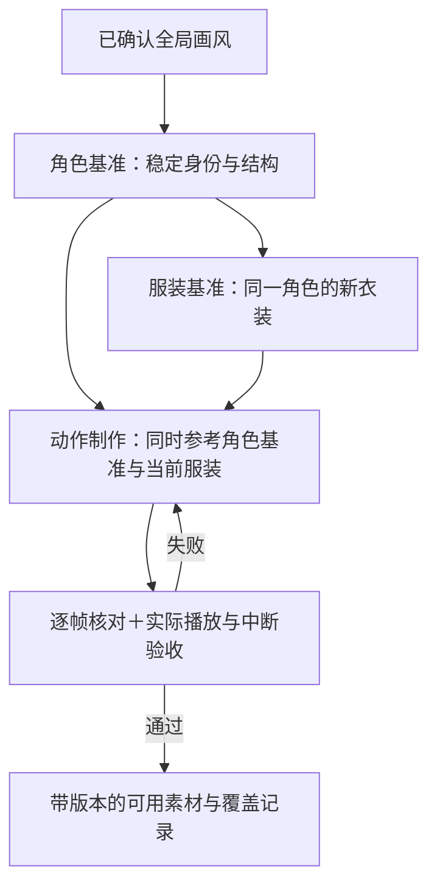

# 动画范围与角色一致性规划

日期：2026-10-25。Codex制作规划建议，尚未由用户确认动作数量、制作或体验验收。产品依据为 [PRD](prd.md) 与 [状态节奏](state-and-rhythm.md)。本轮不生图、不写播放器或素材处理代码。

## 数量：6个行为状态，建议36项动作语义

**6个行为状态保持不变，动画建议规划36项：24项共通基础＋12项特色扩展。** 7种外部工作状态通过5类短反应表达，不再乘以角色数值、服装、视角穷举状态。36是素材规划，不是36个业务状态、36张图或36fps；能合理复用的片段可以支持多个语义，但不能用同一眨眼假称已经做完丰富动作。

| 分组 | 共通基础：24项 | 特色扩展：12项 | 合计 |
| --- | --- | --- | --- |
| 安静陪伴 | A01呼吸、A02眨眼、A03左顾、A04右盼、A05重心微移 | A06耳部微动、A07尾部轻摆、A08整理发丝 | 8 |
| 用户互动 | B01倾听、B02点头、B03歪头、B04挥手、B05浅笑、B06轻声讲述手势 | B07俏皮婉拒、B08含蓄害羞 | 8 |
| 日常活动 | C01伸展 | C02翻书、C03整理衣装、C04小口喝饮品、C05轻玩耍、C06写画 | 6 |
| 休息 | D01坐下、D02安静坐姿、D03困倦、D04睡眠 | — | 4 |
| 工作/连接短反应 | E01专注、E02提醒、E03欣喜收尾、E04关切、E05招呼 | — | 5 |
| 交接与探索 | F01入场、F02退场、F03醒来 | F04出发、F05返回 | 5 |
| 总计 | 24 | 12 | 36 |

- “耳/尾”仅适用于角色确有这些结构；没有的角色用其设定内等价小动作替换，不自动长出新部件。害羞、婉拒的强弱符合个性与友情/亲情边界。
- 24项是建议的共同覆盖语义，不要求首个试样一次做齐。先用呼吸/眨眼、倾听、提醒、入退场等代表性片段验证质量，再补基础库，最后分批补特色动作。
- 出发/返回可先复用已批准的入场/退场，专门的旅行手势作为扩展。休息和提醒必须有适用表现，不能靠强行叫醒、换衣服或瞬移探索者来补缺。
- 更多动作仅扩大表达选择，**不提高自动活动/API/气泡发生频率**。微表情不等于一次日常活动，不为展示库存派工；角色探索时离开桌面，换合资格角色接替。

## 帧数与视角

微动作可从4～8帧、普通动作8～12帧、复杂动作12～24帧开始试样；这些仅是制作建议，最终按动作幅度、关键姿势、节奏与实际尺寸播放决定。单帧可有不同停留时长，待机和挥手不必同速。增加帧数不能自动修复身份漂移、动作弧线、首尾接缝或中断跳姿。

先固定常用三分之四视角做动画。角色参考补正面、侧面、背面与常用三分之四视图用于核对结构；**不要求36项全部制作4个动画方向**。有实际需求再补转身/方向；服装、发饰和标记不对称时不能直接镜像。渲染刷新率与素材帧数分开管理。

## 当前项目已有记录到什么程度

| 资料 | 已有内容 | 缺口 |
| --- | --- | --- |
| [10号风格选择](style-exploration-maid.md) | 用户选定第二轮10号画风与紧凑比例，保留原始参考和提示词 | 这是风格选择，不是已定正式角色身份、精确像素网格或所有视图 |
| [造型资料工具](../../../tools/appearance-catalog/README.md) | 310维度、配方、重点/协调关系，角色稳定性及服装约束C24～C26 | 不含正式角色母版、完整动作库或自动一致性校验器 |
| [动画研究](../Bayper前期调研/animation-research.md) | 母图→多视图→单动作、锚点/时序/调色/素材来源与验收原则 | 尚未形成并验收正式角色的完整制作基准 |
| [像素探针](../Bayper前期调研/pixel-spike-results.md) | 六帧待机、切帧/脚底对齐/播放证据 | PIX-04正式视觉质量FAIL，脸、尾尖、毛色与首尾轮廓漂移 |
| [多动作探针](../Bayper前期调研/action-spike-results.md) | idle/wave/alert共14帧（6/4/4），事件、中断恢复流程 | ACT-07正式素材FAIL；四帧挥手有离散停顿，跨动作比例仍漂移 |

结论：已有记录可复用，但没有可直接扩成大量服装动画的已验收角色母版。探针角色也不是10号画风的正式Bayper，不能混作同一生产资产。

## 同一角色持续扩服装、扩动作的制作基准

| 层次 | 固定什么 | 每次扩展怎样使用 |
| --- | --- | --- |
| 全局画风 | 像素网格、缩放、轮廓、阴影方式、目标屏幕尺寸、头身与相机规则 | 从10号参考实际标定后记录；现在不凭空指定色值或比例 |
| 角色基准 | 稳定角色标识、脸部结构、眼型/色、身体比例、关键发色/标记、耳尾结构，以及底色、习惯与动作气质 | 批准中性完整着装参考、结构多视图与关键表情；区分固定识别点和允许改变处，昵称不当资产身份 |
| 服装基准 | 归属角色与主题、结构/配色/配饰、遮挡关系、衣摆和耳尾开口等 | 先批准该服装视图，再生成动画；允许的发型/头饰变化须显式记录，不能重新抽脸或体型 |
| 动作规格 | 动作语义、关键姿势、视角、画布/尺度、脚底与身体锚点、时序、循环/一次性、可中断收束点、道具 | 每个动作同时引用角色基准和当前服装参考，不能只拿上一张AI生成图继续串行变体；单动作单视角小批生产 |
| 素材依赖与审查 | 角色基准版本、服装版本、动作版本、生成参考/提示词/原图、导出与验收依据 | 修改母版后列出受影响衣装和动作复核，保留已批准版本，不静默全库替换；AI位图不虚称分层工程源 |

角色的统一不仅是脸：安静角色的挥手幅度、活泼角色的节奏、习惯性整理服饰等都要符合设定。亲密和心情调整表达选择，不任意改变骨架与核心身份。

## 多服装动画的覆盖与验收

- 每套可穿服装须有已审查的基础动作覆盖记录；若复用动画，必须确认该服装可直接使用而不穿帮。特色动作可逐步补充，缺失时选同服装已批准且语义适合的动作，不临时换回基础衣服。必需通知文字始终独立可用。
- 提醒/关切等共同语义可有角色专属表现，不要求所有角色一模一样；新服装仅有立绘不能标成可穿用完整素材。
- 先批准少量关键姿势，再生成单段，最后扩批量。每次对照角色母版和服装视图看脸部局部、轮廓、身体比例、关键色/标记和衣装细节；跑正常速度、慢速、首尾循环及跨动作中断恢复，并在实际显示尺寸与深浅背景检查透明边缘。
- 帧间身体变形、衣扣/尾部凭空增减、视角漂移等须返修；切帧、平移、统一缩放只能修位置，不能当身份问题已修。不要逐帧拉伸凑齐体型或靠插帧把错误平滑掉。
- Codex生成与审查图像；Claude Code负责切帧、对齐、打包、检查和播放代码；OpenDesign可预演节奏与交互，不能替代正式素材验收。用户审核最终自然度与角色体验。

本页是后续制作依据，不是已实现的素材管理系统。造型工具继续自包含维护数据；本轮不新增数据库表、素材脚本或大量空目录。
