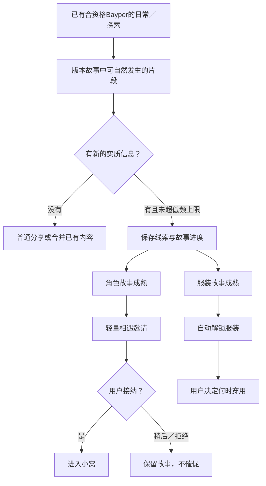

# 角色故事线索与服装发现

状态：用户已接受的首版体验默认，2026-10-25；未实现或体验验证，后续按体验调整。依据 [PRD](prd.md)；活动机会与API额度沿用已接受的 [状态与节奏](state-and-rhythm.md)，不增加新的调用池。

## 核心关系

线索是故事中获得的了解，不是可消耗碎片或货币。不要求做任务、点领取、连续登录或记住进度条；用户可以只感受分享，进度在实际产生时自动保存。

## 线索的归属与内容

| 类型 | 指向 | 可以说明什么 | 不能冒充什么 |
| --- | --- | --- | --- |
| 角色故事线索 | 某位尚未结识、版本已提供的角色 | 她的习惯、经历、居所背景，与已有Bayper的相识关联 | 已入住、已经与你亲历、模型临时生成的新身份 |
| 服装线索 | 已结识角色的一套已发布服装及其主题故事 | 衣服由来、制作/准备过程、与角色有关的小故事 | 新角色、已经穿用或尚无素材却可穿的服装 |

每段保留目标、主题/故事归属、来源活动、实际发生或获知时间、讲述者与新增事实。应用的内容进度不随叙述者换人重置；角色知道哪些内容仍按亲历/转述分别记录，不默认全部人都亲历。

服装发现默认优先面向已结识角色；尚未结识者的服装细节可作为角色介绍背景，不单独开启必须先接纳才能完成的服装任务。

## 产生与低频积累

1. 只有合资格名单成员的正常日常/探索可产生新的发现进展；同屏动画、Agent状态变化、重复点按、换人、重开与临时聊天不另开线索抽取。
2. 已有自动机会触发后，结合当前版本故事与场景选择可自然发生的内容；不叠加一轮必须中奖的抽奖，也不保证每次活动有线索。模型负责符合设定的表达，是否算新事实、是否成熟和是否解锁由产品规则确定。
3. 全应用**滚动24小时最多新增1段有效线索**，角色/服装合用；这是上限，不是每日任务。沿用原API预算，一次活动中产生并表达必要信息，不为判定、翻译成线索或复查再追加模型调用。
4. 同时优先推进**1条角色故事＋1条服装故事**，避免摊开大量未完成事项；这是内部内容安排，不给用户派两项任务。暂缓的相遇/已解锁未穿用内容保留，但不计作必须继续刷的故事线。
5. 初始建议每条短故事用**2段有不同实际信息、顺序合理的片段**形成完整了解：角色故事可以是“初识背景—结识契机”，服装故事可以是“缘起—准备完成”。节点由版本作者设计，不把任意两句模型话拼成完成，不显示“收集2个碎片”。特殊故事节点数可随后按内容调整，不增加角色独有复杂规则。
6. 多条均可推进时优先较早开始且未被拒绝的故事，避免不断开启新人而长期留一堆悬念。由当前合资格角色自然接续，避免必须把某一位固定上岗才能继续。
7. 偏好只用于适度匹配主题与角色，不能把一次选择当永久喜好；亲密度、每日互动次数、外部会话授权、特定Agent任务完成均不作为发现门槛。

线索不会自然过期、遗忘或因版本主题更替清空；它是内容进度，不套用琐碎记忆的淡忘规则。离线不生成线索、不补算漏掉的每日份额，也不丢已有进度。主题故事不设限时领取、倒计时或连续登录条件。

## 重复与冲突处理

| 情境 | 处理 |
| --- | --- |
| 同一事件重放、重连补发或重复回包 | 只保存一次有效进展，不重复通知或解锁 |
| 同一事实换措辞、换讲述者 | 合并来源，可作为自然聊天背景；不再次计为新片段或弹“新线索” |
| 同目标出现新的实质信息 | 按故事顺序补充下一节点，仍受全应用24小时上限 |
| 角色已结识／服装已解锁 | 不重复成为奖品或兑换货币；按普通故事处理，后续合资格机会再考虑其他目标，不当场重抽 |
| 模型说法与角色设定或已知故事冲突 | 不推进、不解锁；以已发布设定与已确认进度为准，保留待修正信息，不再发一轮“补奖”请求 |
| 更新、退出、角色换名单 | 延续稳定的目标与故事进度，不重新计算成新发现 |
| 所有可用故事均已完成或暂无匹配内容 | 停止发现进展，继续安静陪伴与已有故事；不为“必须有产出”增加API或捏造角色 |

重复内容不扣亲密、精力或心情；活动本身的真实消耗沿用原规则，不因它没带来新线索再扣一次。纠正事实不应删掉实际认识过某位角色的关系；进度修正与个人记忆修正分别处理。

## 角色相遇与接纳

首位按愿望匹配首遇流程，不依赖线索。后续角色在故事了解完整、角色素材已发布可用时形成一次轻量相遇，建议通过讲述者引荐或相应故事场景自然出现，不另加刷好感或任务链。

后续**自动相遇邀请全应用滚动7天最多1次**，从实际首次呈现邀请计时，不从接受计时。邀请必须同时遵守已有自动分享气泡频率，必要工作通知优先。故事先成熟但尚不能邀请时安静保存，不额外弹完成提醒后再弹一轮邀请。

一次只保留1个待决定的相遇邀请，可接纳、稍后再说或不接纳。用户主动回看同一邀请不算新的发现，也不靠刷新重抽另一位。

- **接纳**：进入小窝，保留相遇来源与角色稳定设定；不自动更改固定安排、随机位或当前同屏者。
- **稍后**：保留认识背景与邀请，默认不周期催促、不改已有陪伴安排、不因跨日过期。用户想起时再处理即可。
- **不接纳**：结束当前邀请，故事仍可回看；同一角色默认不再自动推送，用户可主动重新开启该已发生邀请。没有惩罚或立即替换成另一位的连环询问。

已有待决定邀请时，不继续推进新的角色相遇故事；服装故事与普通陪伴仍可继续。用户不需要处理旧邀请才能继续聊天或使用Herdr通知。

## 服装解锁与穿用

服装故事成熟、对应角色已结识且素材可用后，**自动解锁并保存**，不要求用户点击领取、消耗线索、支付货币或完成一轮照顾。建议全应用滚动72小时最多解锁1套，限制突然批量涌入；未到时间则保留成熟故事，不发送重复提示。

解锁不等于穿用：告知一次是谁的哪套服装及故事由来，用户决定现在换、以后换或不换，默认保留原穿着。穿用不换角色身份、不重置记忆和数值、不占新角色位置；已有聊天/动作节点先收束再换素材，不抢焦点。

解锁提示占既有自动分享额度，不额外轰炸；暂时不能展示时内容已安全保存，延后一次汇总，不要求领取才能保存。用户可主动查看已解锁内容，查看和重复穿用不产生新解锁事件。

## 版本内容与模型不可用

版本作者提供稳定角色/服装目标、可用素材、故事关键事实与成熟条件；不建设泛用任务系统。模型可以润色或连接片段，不能直接写“已解锁”改变事实，也不能把真实工作目录内容冒充角色虚构经历。

模型不可用时不虚构生成成功，可使用版本已提供、符合当前进度的本地故事片段；纯本地内容不占API请求额度，仍须具备角色活动资格并遵守活动、线索与解锁上限。自动请求失败计入既有预算，不为补线索立即重试。用户不启用外部会话分析时，全部基础发现流程仍可运行。

新版本保留已结识角色、已解锁服装与未完成故事进度，按稳定目标延续；内容暂不可用时说明等待，不重置或换成另一张脸。本轮不设计内容下载、迁移协议或运行数据库。

## 纸面审查情境（非执行证据）

- 连续一周未打开：没有线索损失或活动欠账；回来继续已有故事，不补发一周邀请。
- 同一天多次重开、换人、追问同一故事：已有事实可以聊，不新增有效片段、不重抽。
- 用户一直不处理邀请：陪伴、服装发现和工作通知照常，不靠催促获得下一项功能。
- 新版本增加很多角色/服装：按既有频率逐步遇见，不一次生成大量“待领取”事项。
- 全部内容已体验：仍可安静相处、聊天与记忆成长，不依赖收集驱动日常价值。

本轮不实现线索判定、故事生成、相遇或服装功能。频率和节点数为首版可体验默认，后续按真实体验调整。
