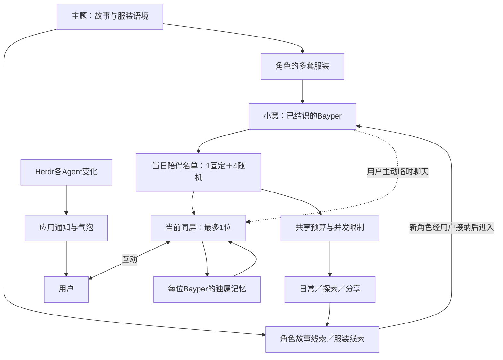

# Bayper PRD

状态：依据用户完整交付授权进入正式实现与验收，按切片冻结设计和Case。完整范围及进度见 [交付工作记录](../Bayper完整交付/scope.md)。更新日期：2026-10-25。

## 产品定位

Bayper是可独立启动的桌面陪伴应用。核心是与具有稳定形象、性格和独属记忆的Bayper长期相处，让工作与等待更有趣。通过连接器接入Herdr后，逐个Agent的状态变化通知是必须履行的能力。

起因是终端AI Coding过程中的漫长等待与无聊。Bayper以动作、表情、偶尔短句、自主活动和主动文字聊天回应用户，偶尔带来小惊喜；不抢焦点、不频繁打断操作。用户与Bayper、Bayper彼此之间建立友情与亲情，不建立婚恋、繁殖或后代系统。个体统一称为“Bayper”或“角色”。

当前首先面向用户本人，优先macOS自用。用户已确定正式桌面技术栈为Electron，以快速迭代为目标；现已进入正式产品实现，既有高保真原型仍只作设计参考。画风采用用户于2026-10-26认可的凛新版像素母版，强调实际小尺寸可辨认的像素簇、阶梯轮廓与清晰色块；继承第二轮10号的紧凑二次元头身与造型方向，2D，不需要3D。制作与验收遵循 [角色画风基准](../../../assets/characters/STYLE.md)；角色具有女性拟人形象特征。

## 业务模型与关系

| 模型 | 业务职责与关系 |
| --- | --- |
| 用户 | 选择陪伴、互动、命名、接纳新角色，控制来源授权；与每位Bayper形成独属经历 |
| 角色设定 | 稳定身份、核心外观、性格底色、背景与行为逻辑，随版本提供，支撑服装和故事一致性 |
| 已结识的Bayper | 用户已接纳、长期保留的角色与关系进度；昵称可自定义，可参与陪伴与活动 |
| 小窝 | Bayper日常归属，承载休息、玩耍；保留不在同屏的角色及其独属记忆 |
| 当日陪伴名单 | 最多1个固定陪伴位＋4个随机位；名单成员有系统自动API活动资格，共用预算 |
| 同屏陪伴位置 | 自动陪伴来自名单；用户可临时找名单外角色聊天，桌面直接互动最多1位 |
| 个体状态与关系 | 底色、习惯、情绪与候选的简化数值，共同影响表达、活动和成长 |
| 独属记忆与共享经历 | 记录每位Bayper与用户的经历；彼此分享时保留讲述来源，不冒称亲历 |
| 日常活动与探索 | 受资格、频率和并发限制，产生分享、故事或线索，不是全体无限并行工作 |
| 主题内容 | 持续版本迭代的故事语境、服装方向、活动素材与线索，是陪伴内容底座 |
| 角色故事线索与服装线索 | 连续积累的发现进度，分别指向新角色和既有角色的服装内容 |
| 角色服装 | 同一角色的多套外观，归属具体角色并关联主题；换装不重置身份、记忆或关系 |
| 造型元数据库 | 全身构造维度、候选和协调约束，制作阶段形成配方与素材 |
| 连接器及Agent | 应用对外关联与来源身份，每个Agent独立状态，不与角色人格绑定 |
| 通知与气泡 | 对真实事件去重、聚合、排队；由角色转告或由应用直接表达 |
| 模型服务与调用预算 | 支持互动与自动内容，首次配置必要；角色自动活动受名单与共享预算约束 |

## 用户已明确的核心约束

| 编号 | 当前要求 |
| --- | --- |
| REQ-01 | 有生命感、能互动的长期陪伴优先，同时具备Herdr Agent必需通知 |
| REQ-03 | 自主活动不频繁、不抢焦点；主动互动回应丰富、有性格 |
| REQ-05 | OpenAI API兼容模型接入；首次打开必须设置API Key |
| REQ-06 | 每个已观察到的Agent状态变化必须通知，不被性格、心情或活动压制 |
| REQ-09 | 熟悉感、性格与记忆跨次相处连续，重要偏好与共同经历长期保留 |
| REQ-13 | 外部会话分析默认关闭，设置启用不替代对应目录明确访问授权 |
| REQ-18 | 明确纠正及时更新记忆，旧理解不能继续生效 |
| REQ-21 | 独立于Herdr运行，双向启动自动关联、重连并避免重复上线通知 |
| REQ-28 | Agent状态独立，不把多个Agent合成一个状态 |
| REQ-35 | 多气泡排队，同屏N个并存并按各自展示时长消散 |
| REQ-39 | 后续素材遵循当前角色画风基准：新版明确像素表达与10号紧凑头身方向 |
| REQ-40 | 全身造型维度细分，以少量重点元素带动其余维度整体协调 |
| REQ-41 | 可用SQLite组织项目数据；工具在tools内自包含并向外提供能力 |
| REQ-44 | 小窝承载休息、玩耍与日常归属，同屏直接陪伴最多1位 |
| REQ-45 | 角色身份与核心形象稳定，昵称可自定义，同一角色可有多套服装 |
| REQ-46 | 可结识角色范围随版本提供的角色内容扩展 |
| REQ-47 | 当日陪伴名单最多1个可更换角色的固定位＋4个随机位 |
| REQ-48 | 名单内最多5位都有系统自动API活动资格，共用频率预算、限制并发；同屏仅1位 |
| REQ-49 | 形象、行为、底色、习惯和情绪表现符合统一角色设定 |
| REQ-50 | 以叙事性格为基础，采用亲密度、精力、心情三项简单数值，按已接受默认规则运行 |
| REQ-51 | 各角色拥有与用户的独属记忆，可通过彼此分享获知经历 |
| REQ-52 | 新角色发现不频繁，依赖已有角色探索/日常产生的角色故事线索；服装亦有线索 |
| REQ-53 | 活动与探索有限制，不让全部已结识角色同时出发或各自无限触发API |
| REQ-54 | 主题支撑持续版本迭代的小故事、服装与陪伴内容 |
| REQ-55 | 首次完成模型配置后，用户简单表达愿望，按已发布角色特征排序，相遇并确认接纳第一位Bayper |
| REQ-56 | 自动同屏轮换由当前Bayper精力触发，完成当前自然节点后才退场，聊天中不自动切换；避免频繁安排活动 |
| REQ-57 | 用户可主动找名单外已结识Bayper临时聊天，不自动修改当日名单或授予系统自动活动资格 |
| REQ-58 | 状态语义由Bayper统一定义，连接器映射外部事实，关联帧动画与角色数值变化；变化依据须明确 |
| REQ-59 | 线索产生、积累、相遇与服装解锁保持低频自然，不要求刷任务、照顾、连续登录或反复领取 |
| REQ-60 | 每位Bayper持有独属记忆，角色共享有明确来源与接收者，不默认全员共享 |
| REQ-61 | 用户明确纠正或删除后，相关副本、共享派生与后续使用同步生效，操作简单自然 |

下文的Codex细化建议不等于用户逐项确认，没有实现或体验证据的内容不标成已验证。

## 小窝、陪伴名单与同屏位置

- **已结识角色数量**：随版本可结识范围扩展。接纳新角色由用户确认，可暂缓或拒绝；身份长期保留，回小窝、换装或轮换不重新结识。
- **当日陪伴名单**：最多5位，1个用户指定的固定陪伴位＋4个随机位。固定位持续保留所选角色，用户可换人；固定的是安排，不是让该角色一直占据桌面。固定与随机位不能重复选择同一角色，人数不足不复制凑满。
- **同屏陪伴位置**：自动陪伴从名单中产生，最多1位直接可见互动；用户主动找名单外角色时可临时替换当前同屏者，不修改名单。其余角色在小窝或活动状态，不因名单有5位而同时出现5个桌面形象。小窝的具体画面与管理入口待设计。

用户已确认：名单内最多5位均有系统自动模型活动资格，但共用频率预算并限制并发。自动同屏轮换依据当前角色精力，在自然节点完成后进行，聊天中不切换；用户主动选择优先。名单外临时聊天不改名单。用户已接受当前名单刷新和轮换方案，具体数值与频率仍按本轮首版默认讨论，尚未体验验证。

名单中的Bayper以“一日秘书”的方式陪伴用户工作，固定位提供持续指定的陪伴，随机位带来不同角色轮换的日常体验。

### 名单刷新与候场（Codex细化建议）

- 按用户本地自然日生成名单，每天首次使用时生成；同一天重启、恢复、换装或临时聊天复用原名单，不反复重抽。
- 固定位延续用户选择；随机位从其余已结识角色中无重复抽取，倾向近期较少参与者，不强保每人每天上场。初始只有1位时仅填实际可选角色，建议首位默认进入可更换的固定位。
- 新日计算名单与桌面退场分开。跨日聊天继续原会话，显示切换等当前节点完成并退出主动聊天后再进行；被换出名单者停止新自动活动，不为延长显示而继续取得后台机会。
- 临时聊天、固定安排改人、新角色接纳都不触发其余随机位重抽；新角色可以临时聊天或被设为固定成员，也可等待后续日名单。
- 精力低只影响候场，不消除成员资格或刷新整个名单；系统不为凑足5位或完成“轮班次数”强迫角色工作。

### 精力与自然轮换

用户已明确精力是自动轮换依据，并强调不要频繁安排Bayper活动。Codex建议把低精力作为“准备休息”的条件，不按固定短周期反复扣精力、派探索、换人。安静陪伴不是持续高消耗工作；普通本地表情、等待和事实通知不逐帧、逐气泡扣精力，也不为消耗精力而制造API任务。精力恢复不要求用户喂养或反复点击。

低精力时先停止追加自动活动，完成当前短自然节点，再从名单内可陪伴、未探索且已休息的角色中选择接替者。当前讨论默认为精力≤30准备休息，恢复≥60且距上次自动退场至少30分钟才候场，避免临界值反复换人；恢复和消耗详见状态与节奏规则，后续以体验调整，不安排短周期强制轮班。

自然节点指一段已开始的短表达、当前互动回合或动作循环的收束点，不是整场聊天、全部故事或无限等待的后台队列。聊天期间不自动换人；用户主动切换优先在当前短节点结束后交接，未完对话和记录仍归原角色。失败或取消按真实结果结束该节点，不伪称成功，也不为了收尾再追加一串活动。

没有合适接替者时，可保留当前角色的本地安静休息表现，不强行唤醒、派工或临时启用名单外自动角色；应用继续通知。临时聊天结束后优先回到之前的名单内同屏角色，若其正在休息或探索则按候场规则选择，不在聊天关闭瞬间制造连环切换。

### 互动与气泡衔接（Codex建议）

- 主动聊天/互动期间不自动轮换打断；切换不丢失对应角色上下文、记忆归属和用户操作。
- 日常短句、分享和邀请主要由当前同屏Bayper表达；其他名单成员的异步成果先保留，可上场后分享。若提前以留言显示，必须标作者，不由当前角色冒称亲历。
- 必需工作通知由应用独立排队，同屏角色转告时标清连接器与Agent来源，不将转告者当成Agent。
- 无可显示角色、休息/探索、切换或模型不可用时，仍提供应用层事实通知，不为通知临时生成第二个同屏角色。
- 气泡N与角色1分别计数；聊天与故事不能挤占必需通知机会。普通气泡3个位置之外另设加急气泡位置，具体视觉布局待原型核实。

详细规则见 [陪伴、活动与线索](companionship-rules.md)。

## 活动资格、探索与模型机会

只有当日陪伴名单内的Bayper可以被系统抽取到自动API活动机会。名单外角色可保留本地休息/玩耍表现与已有记录，但不各自进行后台推理、探索抽取或自动生故事，不能换个活动名称绕开资格。

Codex建议以下讨论默认：

1. 先检查名单、当前状态、活动冷却和全局预算，再抽取机会；抽中不等于必产线索。
2. **角色自动模型请求全局最多1个在途，探索活动默认最多1位同时进行。** 调用并发与持续活动分别限制，不因有5位名单成员放大成5路并行。
3. 用户明确：当前同屏角色开始探索时，完成短节点后退出桌面，由合资格名单成员接替；聊天中不自动启动探索或换人。Codex补充建议：无可接替者就不让当前同屏者启动自动探索，保留安静陪伴/休息，不强派别人。探索者不同时占同屏位置。主动找探索者聊天与暂停恢复的补充建议见陪伴规则。
4. 各角色共用频率与调用量预算，重复活动合并、预算用尽等待；预算不足不取消必需通知，不假称活动完成。
5. 用户主动聊天是显式请求，不参与随机抽签；名单外已结识角色可以临时聊天及临时同屏，不自动换入名单，也不附带随机探索、分享等系统活动资格。显式聊天仍受服务可用性与用户调用设置约束。
6. 经授权会话分析如需模型，也遵守应用预算和外发约束；角色视角的自动分析只归给合资格成员。首版不另开独立全局模型整理任务，不设隐藏无限调用池。
7. 模型不可用保留进度，采用本地动作/已有内容；符合进度的版本本地故事仍可产生线索，受原资格与上限限制，不捏造生成成功。休眠或日界恢复不集中补发积压调用。

用户已接受以下体验起点：每30分钟评估一次自动机会、合资格时25%概率选一位；自动API全局滚动1小时最多1次、8小时4次、24小时6次；探索全局滚动4小时最多1次、24小时最多2次，并发1位。上限不是工作目标，锁屏/休眠不补抽；主动聊天和必需通知分别处理。完整计数、冷却与气泡频率以 [状态与节奏规则](state-and-rhythm.md)为准，后续体验调整，不由模型自行改预算。

## Bayper统一状态与动画语义

首版采用用户已接受的 **6个角色行为状态＋7种统一工作状态**，避免把外部Agent事实、角色心情和行为混为一套状态。角色行为、工作状态和数值各有归属，动画按语义映射，不穷举所有组合，后续体验调整。

| 层次 | 首版内容 | 作用 |
| --- | --- | --- |
| 角色行为：6种 | 陪伴、互动、日常、探索、休息、交接 | 决定当前角色行为与主动画，实际互动/活动结算数值 |
| 统一工作状态：7种 | 空闲、工作、待处理、已结束、异常、已停止、未知 | 每个工作对象独立维护，由连接器据来源证据映射，进入通知队列 |
| 短反应动画：5类 | 专注、提醒、欣喜、关切、招呼 | 工作事件的短暂表达，结束恢复原行为，不额外乘出长期状态 |
| 个体属性 | 亲密度、精力、心情 | 影响表达与活动意愿，不代替外部事实，不压制必需通知 |

工作状态变化默认不直接增减角色数值；实际共同互动、角色日常和探索才按相应规则结算，重复帧、快照、气泡或重试不重复扣分。角色休息时可仅展示事实气泡，探索中不瞬移回屏；聊天不为工作反应强退。连接状态独立描述来源连通事实，断联不推定Agent完成或失败，来源done也不等于业务验收成功。

用户已接受的状态默认、帧动画语义、映射证据与中断恢复详见 [状态与节奏规则](state-and-rhythm.md)，不代表连接器已支持全部映射或帧素材已制作。Codex本轮提出的36项动作候选与角色/服装一致性方案见 [动画规划](animation-plan.md)，尚未用户确认；动作数量不改变6个主行为状态。

## 角色、服装与主题

### 稳定角色与形象一致性

每位Bayper有稳定身份、核心外观、背景、性格底色与行为逻辑，用户可以修改昵称。初见的未知感是逐渐认识她，而不是每次重新抽取人格。

形象设计需同时定义外观、动作和典型反应。不同服装下保留可识别的脸部、体型、物种特征和关键标记；发型等局部变化的范围由角色设定约束，具体锚点待制作。换装不清空关系、改写记忆或抽换底色；习惯与情绪在该底色和真实经历中成长。

### 主题与可持续内容

**角色拥有多套服装；主题在服装与故事下提供统一语境，组织版本内容。** 同一主题可关联多位角色的服装与故事，角色也可参与多个主题。主题不是角色身份。

首批服装内容方向为“女仆系列”。版本围绕主题设计小故事、活动、服装和线索；模型可在已发布角色设定和内容边界内生成短句、故事片段或探索分享，不自行创造可用服装、解锁结果或角色关键事实。

美术在制作阶段生成并验收，随版本提供，不在应用运行时生成图片。服装须有对应动作与视图适配，单张立绘和标签不等于可穿用素材。

### 造型元数据库

[造型资料工具](../../../tools/appearance-catalog/README.md)自包含维护维度、候选、配方、约束、参考图及SQLite。310项维度是构造词库：先定义角色核心与主题意图，突出少量重点，其余形态、服饰、配色、动作与表达围绕它们协调，不要求每项都被强调。

角色固有特征、服装可变部分、画风固定项与表达有明确归属，确定后固化到相应配方，不在每次生成动作时重抽。精确像素网格、色板、锚点和不可见结构仍需标定，工具不声称已实现自动审美求解。

参考依据见 [10号选择记录](style-exploration-maid.md)。正式可发布角色与服装素材目前为0，纳入完整交付的美术制作与验收，不将参考图直接标为正式素材。

## 性格、三个简化数值与记忆

### 叙事性格

- **底色**：与形象、背景、行为共同设计，相对稳定，初见逐渐显露。
- **习惯**：从实际互动和共同经历成长，形成该Bayper与你特有的表达。
- **情绪**：短期变化，起伏可理解，不直接等同于长期性格被改写。

普通互动允许不完全配合和自己的偏好，不得压制Agent通知；亲密表达仅体现友情和亲情。

### 数值首版默认（用户接受，待体验）

| 数值 | 建议尺度 | 含义与影响 |
| --- | --- | --- |
| 亲密度 | 0～100，初始10 | 有意义互动和真实共同活动分别可＋1，每位每天最多＋2；离线、忽略邀请、换人、纠正不扣 |
| 精力 | 0～100，初始100 | 同屏安静陪伴－6/小时、有效互动－2/15分钟，时段不叠加；日常－2、探索－8各一次；小窝/离线＋10每小时，休息＋20每小时，封顶100 |
| 心情 | -2～2，初始0 | 愉快互动/活动可＋1、真实活动受挫可－1，同类影响冷却；无新影响每30分钟向0回归一档，不因没回应或API故障惩罚用户 |

用户已接受以上数值、变化与恢复作为首版默认，后续体验调整。数值由实际事件和本地规则结算，不额外调用模型打分；亲密不设置照料欠账，精力自动恢复，心情自然回归，不用数值催促用户。时段互斥、活动扣除、阈值与冷却的唯一详细规则见 [状态与节奏规则](state-and-rhythm.md)，不增加复杂能力树。

### 独属记忆与彼此共享

每位Bayper保存与用户的独属互动、重要偏好与共同经历，跨次相处连续；换同屏角色、昵称、服装或模型不清空其历史。真实经历按参与者归属，不默认全员都亲历。

用户已接受首版记忆与共享默认，以 [独属记忆、共享与修正](memory-and-sharing.md)为详细依据：

- **记忆归属**：直接告诉某位角色的事情、她实际参与的共同经历与执行活动归她；外部分析保留来源和推测性质，共享所得记录为转述。新角色不自动获得其他角色历史。
- **定向共享**：轻量主题日常/探索见闻可以一对一少量分享，建议全应用24小时最多1次自动共享，消耗已有活动/API预算；自动不二次转发。私聊偏好、个人内容、工作细节、外部分析推测默认不自动分享，用户可指定只告诉谁或禁止分享。
- **接收不等于唤醒**：接收者保留“谁告诉我”的来源，不冒称亲历；用户指定名单外角色时可本地投递，不触发其自动API、不改名单或同屏位置。
- **纠正范围**：明确纠正默认同步到已持有同一错误理解及相关副本/派生内容的角色，不将新事实广播给原本不知道的人；“最近这样”保留时效，不永久推翻长期偏好。
- **删除范围**：“忘记这件事”默认清除各角色已持有的对应可用记忆与派生内容；用户明确“只让A忘记”时按A处理并阻止自动回流。可以从当前话题/选中条目定位就直接处理，歧义时才问最小范围，不要求逐角色下令。
- **同步时机**：先停用旧理解再确认完成，检索、摘要、待发分享、已载入上下文和在途结果都需检查有效性；未上场角色也立即受约束，不等她下次API再修正。旧聊天/来源重新分析不得自动学回，用户之后明确重新交代可建立新理解。
- **轻负担**：重要偏好/共同经历长期保留，琐碎细节自然淡化；不逐条弹审批、不以亲密门槛决定纠正有效性，删除与纠正不扣数值，不让角色轮番确认。

记忆删除不自动删除聊天原文、外部文件或撤回已发送的服务商请求；这些来源不能被用来恢复已删除的理解。角色结识、服装解锁等内容进度保持，但相关展示不能带回被删个人信息。只保留必要的最小防回流控制，不保留可继续使用的已删正文。分享不传递目录读取权限。

上述默认用户已接受，后续体验调整；尚未实现或体验验证。直接沟通、共同活动和获准Coding Agent会话均可提供来源，外部目录不是记忆载体；分析所得先作为初步了解。存储、判定、来源关联和同步实现仍待研究，既有SQLite局部实验不证明完整语义已通过。

## 线索、发现与接纳

### 第一次相遇

完成模型配置后，用户简单输入想要怎样的陪伴，例如希望安静陪着、偶尔活泼聊天，结合版本已发布角色的稳定特征排序，先推荐一位相遇，再由用户确认接纳。首遇不依赖先有角色出门探索。

Codex建议：愿望可短至一句，也允许“没有特别想法”；排序以角色特征与陪伴风格为依据，不现场捏造新角色或重写性格来迎合愿望。匹配只用于首遇推荐，不当作永久偏好。用户不接纳时可调整愿望或查看其他可选角色，不无限抽签；未接纳前保持首遇流程，不以沉默创建关系。首次接纳后进入小窝与初始陪伴安排，后续角色再通过线索发现。许愿的名称与表现形式待设计，不引入额外货币或抽取次数系统。

### 后续发现

新角色发现不频繁，依赖已有Bayper合资格的探索与日常活动产生**角色故事线索**；**服装线索**指向相应角色的服装。线索有归属与连续进度，重复合并，不把每次API输出都算新发现。

体验采用轻量相遇、连续线索和同伴引荐，居所可以是背景，不先做地图或任务系统。发现以版本实际提供且素材可用的角色/服装为范围；模型负责表达，规则决定进展与解锁，不虚称未完成内容已可使用。

用户已接受首版线索规则，详细依据统一见 [角色故事线索与服装发现](clues-and-discovery.md)，后续体验调整：

- **产生与积累**：沿用已有活动/API机会，滚动24小时全应用最多1段新有效线索，不增加抽取或模型评审调用。优先推进1条角色故事、1条服装故事，默认各用2段有不同信息的作者设计节点形成完整了解；进展自动保存，用户不必领取或做任务。
- **重复与持续**：同事件重放、同事实换说法或换讲述者均合并，不重复推进/提醒。进度不因离线、跨日、换人或主题更新清空，不套用普通记忆淡忘；无新内容时继续陪伴，不当场重抽或强造发现。
- **相遇与接纳**：后续自动相遇邀请全应用滚动7天最多1次，同时最多1个待决定邀请；用户可接纳、稍后或拒绝，沉默不当同意、不催促、不惩罚。拒绝后同位默认不再自动推送，用户可主动回看并重开已发生邀请。接纳后进入小窝，不自动改变陪伴名单或同屏位置。
- **服装解锁与穿用**：已结识角色的服装故事成熟且素材可用后自动解锁保存，建议全应用滚动72小时最多1套；不消耗线索、不用点领取。解锁告知一次，换穿由用户决定，默认保留当前衣服，穿用不重建角色或记忆。
- **低负担**：不设线索期限、每日清单、连续登录或亲密门槛；邀请和解锁提示仍占已有自动气泡额度，不另开轰炸通道。锁屏/离线不生成进展，也不欠任务；已有邀请不处理不影响聊天与通知。

节点数、邀请与解锁间隔已作为用户接受的首版默认，尚未实测，后续体验调整；按完整交付切片实现并验收。

## 模型配置与来源授权

首次打开必须配置OpenAI API兼容服务的API Key，完成前不进入正常使用。其他连接信息、实际连通验证、失败重试待细化。真实服务验收使用获授权配置，不在聊天提供Key，不默认读取实际工作会话。

外部会话分析默认关闭。Bayper可发现可用Coding Agent与对应目录，但发现不等于授权；设置启用后仍必须明确请求并获得目录访问授权才分析。支持清单、发现能力、历史深度和外发内容仍待核实。撤销授权与停用后的处理建议见记忆规则。

Key配置、Herdr状态接入、外部目录授权与自动API机会是不同边界，不能互相替代。模型暂不可用与首次未配置分开处理，不推定断线就必须退出。

## 独立运行与连接器

### 运行关系

Bayper 有自己的启动、运行和退出生命周期，不依赖 Herdr 已安装或正在运行。没有 Herdr 连接时，仍可进行日常活动、直接互动、文字聊天与已有记忆支持的陪伴；首次使用的强制模型配置要求保持不变，已完成首次配置后，模型故障保留本地陪伴、已有内容和连接器事实通知；聊天如实说明暂不可用，不伪造模型回复或清空记忆。首次连接验证与修复入口仍待后续细化。

“连接器”是Bayper关联外部应用的边界。Herdr插件与对应连接器关联，外部上线/下线和工作事件进入Bayper表达；插件启停只影响其对应连接，Bayper保持独立生命周期。

### 已明确的相处场景

| 场景 | 期望 |
| --- | --- |
| 独立打开 Bayper，Herdr 未运行 | 完成首次必要配置后，桌面陪伴可以正常陪伴，等待未来建立连接 |
| Bayper 已运行，Herdr 启动并建立关联 | Bayper 向用户提示“Herdr 已上线～”，开始接收其工作状态变化 |
| Herdr 已运行，随后打开 Bayper | 在对应插件可用的前提下自动发现并连接；首次建立该关联后提示上线，不要求用户重启 Herdr |
| 已连接的来源暂时断联后恢复 | 自动重连；同一来源恢复不反复播报“已上线”，具体恢复提示按下方规则 |
| Herdr 已连接，Agent 状态发生变化 | 必须通知用户，表达可带角色性格，通知不能被自主性取消 |
| Herdr server stop | Bayper 向用户提示 Herdr 下线，结束该连接的在线状态，Bayper 自身继续运行 |
| 未来接入其他应用 | 沿连接器边界扩展，不将所有外部来源固定成 Herdr 概念 |

这里的上线提示由 Bayper 向用户表达，不是将该提示发送给 Herdr。上线代表对应关联已经可用；下线与 Agent 的任务完成是不同事件，不互相替代。

### 连接器、实例与归属（当前已认可）

Bayper 核心只需要理解连接器类型、具体连接器实例、来源身份及其事件，不要求所有连接器都具有 Herdr 的 server、session、pane 结构。Herdr 插件是对应的适配入口；Herdr 侧的具体层次由 Herdr 连接器解释，再向 Bayper 提供可区分的来源和 Agent。

用户本轮认可当前按以下关系组织：

| 对象 | 归属与职责 |
| --- | --- |
| Herdr 连接器类型 | 说明怎样与 Herdr 插件关联，以及怎样解释 Herdr 的连接与工作事件 |
| Herdr 连接器实例 | 当前一个 Herdr server 对应一个实例；多个 server 表现为多个 Herdr 来源实例，各自上线/下线 |
| 会话与来源内上下文 | 由所属实例维护，作为 Agent 的归属和显示线索；不因为增加会话就要求 Bayper 核心创建新连接器类型 |
| Agent | 在来源实例内独立识别和维护状态，可附带所属会话/工作区/终端的可读信息；不与其他 Agent 合成一个总状态 |

用户本轮已接受“一个 server 一个实例、会话在实例内、Agent 独立”的当前归属方案，后续修订需同步影响记录。身份不能仅使用显示名称或局部 pane ID：应能区分来源实例，以及同一位置中新启动的 Agent；具体稳定标识与运行代次留待技术设计。一个实例下线不代表其他实例下线。

角色、陪伴位置与连接器/Agent归属分别维护，新增来源不自动增加角色或同屏形象。多个实例有可辨认的名称或线索，使用户知道哪个Herdr来源上线、哪个Agent发生变化。

### 自动发现、重连与上线提示（Codex 建议规则）

用户已明确双向启动顺序都应自动关联、断连自动重连、避免重复上线播报。建议将连接事实与提示分开处理：

| 情境 | 连接行为 | 提示行为 |
| --- | --- | --- |
| 本次 Bayper 运行中首次发现并成功连接某来源实例 | 开始接收事件并取得当前状态 | 对该实例提示一次上线；重复发现、登记、握手或心跳不重复播报 |
| 同一来源运行期间短暂断联 | 自动尝试重连，暂时保留来源身份；其 Agent 状态标为暂不可确认，而非任务完成 | 短暂抖动不反复触发上下线动画；持续断联满默认 3 秒后提示一次“暂时断联，正在重连” |
| 同一来源恢复 | 恢复连接并对账当前各 Agent 状态 | 不重新播报“新上线”；若此前已提示断联，可提示一次“连接恢复” |
| 确认对应 Herdr server stop | 结束该来源本次在线生命周期，Bayper 继续运行 | 提示该实例下线一次；重复断开信号不重复通知 |
| server 真正重启并重新可用 | 识别为新的来源运行周期，并重新关联 | 允许新的上线提示一次，不把真正重启当作重复握手过滤 |

“第一次连接”对已经运行的 Herdr 也适用；不能要求只有插件 startup 与 Bayper 同时运行才可接入。Bayper 打开时的初始状态快照用于建立现状，不冒充刚发生的 Agent 状态变化。

自动重连持续到来源恢复，或用户明确断开/停用该连接；不以后台重连绕过用户主动停用。重试节奏留待技术设计；暂时断联提示的默认观察期为 3 秒，详见通知方案。暂时联系不上不能直接证明 server 已 stop；若实现无法明确区分，需保持断联/未知语义并如实说明，不虚构停止事实。

### 独立 Agent 状态与通知节奏（Codex 建议规则）

每个 Agent 的状态与变化独立记录。A 在工作、B 需要用户介入、C 已完成时，三者应同时保持各自状态；不能用“Herdr 整体工作中”覆盖 B 或 C，也不能只关注当前聚焦的一个 Agent。

建议把状态更新、通知内容与Bayper表演分开：

1. **状态及时更新**：已观察到的真实变化立即更新对应 Agent 的状态，不等待动画结束或播报轮到它。同状态的重复快照/重放可以去重；“工作→待介入→工作”是真实的多次变化，不能因首尾相同就抹掉中间事件。
2. **短时间成组表达**：同时或短时间内出现多条变化，可以用一条清楚的合并播报承载多个 Agent 的变化，并保留各自可回看的通知明细。例如“A 已完成；B 需要你确认”，这是合并呈现，不是合并 Agent 状态。同一 Agent 短时间多次变化也应表达过程，例如“B 曾等待确认，现已继续工作”，不能只留下最终工作状态而隐藏中间变化。
3. **动作保持可读节奏**：同一时刻不因多个 Agent 争抢而快速切动作；按下方默认最短展示时间与可中断规则执行，后续以体验调整数值。已更新的状态明细与正在表达的历史事件应可区分，不能把过时的“开始工作”当作当前仍在工作。
4. **重要事件优先且保留其他变化**：建议需要用户介入的事件优先、完成事件随后、普通进展按节奏表达。被打断或尚未表达的通知仍须进入后续合并播报/明细，不能因冷却或性格而丢失；避免普通变化被持续高优先级事件无限拖延。
5. **避免积压后的连续爆发**：重连或短时大量变化后，先对账现状，再清楚汇总已有记录；不逐条重放过时动画制造通知轰炸。每个受影响 Agent 的变化仍可区分，不能仅以“有多个更新”替代必要内容。
6. **去重针对事件身份**：同一真实事件只通知一次；同一 Agent 后来再次进入相同状态属于新的变化，仍需通知。Agent、连接实例的身份与运行周期参与区分，具体幂等方式留待实现设计。

以上策略与下方数值作为待验证默认方案，用户要求保留后续体验调整。通知采用多气泡队列，具体样式与声音尚未确定。必需通知要让用户明确感知，不能只在后台写记录。

断连造成的未观察历史，沿用前期研究边界：恢复快照只恢复当前状态，不能虚构缺失事件。需要提示恢复期间的观测缺口；已知事件去重、当前状态对账与历史是否完整分别判断。

### 播报与通知的默认数值（Codex 方案，待验证）

这些数值用于后续原型与验收场景的起点，调度器按完整交付计划实现，尚不宣称已验证无漏通知或无闪动。

#### 优先级、聚合与最大等待

| 优先级 | 适用事件 | 最长聚合时间窗 | 首次可见的最大等待目标 |
| --- | --- | --- | --- |
| P0：需要用户处理 | 来源明确表达的待确认、需输入或其他需要用户介入的变化 | 0.5 秒 | 1 秒 |
| P1：重要结果/连接异常 | 本次工作结束、结果待查看、明确失败或停止；确认来源下线、持续断联提示 | 1 秒 | 4 秒 |
| P2：普通进展/连接提示 | 开始或继续工作、普通空闲等其他真实状态变化；首次上线、同周期连接恢复 | 2 秒 | 8 秒 |

优先级依据来源已经确认的含义，不凭模型猜测任务成功或错误；Herdr的done不自动等于业务成果成功。统一状态按状态与节奏规则解释，各连接器的真实字段映射仍需核实。不能确认语义的变化先作为未知按P2表达，不静默过滤，也不伪造失败/成功。

- **计时起点**：从 Bayper 接收该真实变化并识别其身份时计时；不含外部传输延迟。持续断联提示先观察 3 秒，仍未恢复才产生一次 P1 通知；确认 server stop 无须额外等待这 3 秒。
- **固定收集窗**：窗口从这一批最早未表达事件开始，不因后续事件不断到达而延后；可提前结束窗口，各事件按普通或加急通道表达。每个事件仍保留自身的目标截止点，不能借追加事件或合并批次重置计时；普通气泡排队与加急通道分别处理，不把入队冒充可见。
- **最大等待的含义**：变化内容进入用户可见的通知表达，包括具名的分组子项；不要求每个事件各占一次独立气泡、独立台词或完整动画。仅在后台记入历史不算达标。默认不自动发声或生成系统弹窗；这两种渠道的启用方式另议。
- **调度与公平性**：P0进入独立加急位置，不等待普通气泡空位；P1/P2在普通队列按最早截止时间处理，同级按接收顺序。两条通道互不抢占，不能因P0持续到达饿死普通通知。时效为待实测目标，不靠丢弃事件或无限增加窗口保证。
- **模型不阻塞必需通知**：若个性化措辞未及时可用，先用已知事实形成简短表达，满足截止时间；后续不为换一句模型台词重复通知同一事件。

#### 最短展示与防闪动

| 呈现对象 | 默认值 | 例外与含义 |
| --- | --- | --- |
| 普通通知内容 | 至少可读 4 秒 | 不因低优先级事件到达立即换掉；用户主动关闭除外 |
| P0 内容 | 至少可读 6 秒 | 仍需介入时保留稳定的待处理标记，不每隔 6 秒重新弹出 |
| Bayper一次状态表达动作 | 默认至少保持 1.5 秒 | P0 可在合适过渡点中断低优先级动作；必要文字通知不等待动作结束 |
| 普通气泡位置 | 3个 | 承载P1/P2等普通通知，满额排队；与同屏角色数、陪伴名单人数分别计数 |
| 加急气泡位置 | 普通3位之外独立预留1位 | 承载P0紧急事件，不挤走普通气泡，不抢输入焦点 |

用户明确采用“3个普通位置＋独立加急位置”。普通气泡并行展示加排队：有空位即可显示，满额等待；每个实际显示后至少可读4秒，再逐渐消散。P0直接使用加急位置，至少可读6秒，不占普通3位、不缩短普通气泡的阅读时间。

Codex细化：多个P0接连到达时，在同一加急气泡内按来源/Agent追加具名事件，保持已有内容稳定，不反复销毁重建气泡。每条新增内容独立保留至少6秒阅读时间，待处理标记随事实恢复更新；全部原始变化保留可展开明细，不用“还有N条”代替事件来源和含义。加急表达不等待模型生成或角色动作结束，不自动激活输入窗口。

若某条待介入事件在窗口结束前已恢复，仍表达“曾需要确认，现已继续工作”，按原 P0 截止时间呈现；当前待处理标记同时清除，不以过时指令继续催促用户。通知记录保留真实顺序。

加急位置解决普通3位满额时P0排队的问题。加急内容的分组、可读布局与极端突发下的实际时效留在呈现和调度的工程验证中，不把独立位置等同于无限显示容量。

#### 批量、积压与重复的处理

- 每个真实变化保留连接器实例、Agent 身份、发生/接收时间（来源未提供时不补造）及表达状态；去重仅合并同一事件的重复传送，不合并两个不同 Agent，也不删除同一 Agent 的往返变化。
- 同批表达可按 Agent 分组，例如“来源甲：A 已完成；B 曾等待确认、现已恢复”。多 Agent 大批到达时，每个受影响 Agent 都有具名子项及变化详情；可以成组阅读，不逐个播放独立动画或语音。折叠摘要必须能显露受影响来源/Agent 和当前含义，不能只剩一个笼统计数。
- P1/P2在普通队列持续推进，P0在加急位置独立表达；动作可以代表当前高优先级情境，但具名内容必须区分各Agent，不生成“所有Agent的综合状态”。
- 恢复后新收到的补发历史按此次接收时间进入一次汇总，标注历史与当前状态：已结束的历史待介入/结果按 P1，其他历史进展按 P2，分别遵守 4/8 秒截止时间。断连前已接收但未表达的事件不能借重连重置其原截止时间；若某个 Agent **当前**仍需介入，对该现状用 P0，以 1 秒内可见为目标；该P0走独立加急位置，不等待普通队列；时效仍需实际验证。无法观察到的缺失历史单独说明，不补造变化或成功事件。
- 已经通知过的 P0 持续不变时，不定时重复弹出；保留待处理标记。用户处理后再次进入待介入，是新事件，重新通知。短断联自动恢复且未达到 3 秒观察期时，不新增上下线播报。

#### 用于审阅默认方案的时间示例（非执行证据）

| 构造场景 | 默认方案的期望 |
| --- | --- |
| t=0 A 开始工作；t=0.4 B 需要确认；t=0.7 C 完成 | B以t=1.4前在加急位置可见为目标；A/C可在普通位置成组提前显示，三者状态分别保留，不连闪三段动作 |
| t=0 正在显示1个普通气泡；t=0.2 D 需要输入 | D直接走加急位置，以t=1.2为目标；普通气泡按自身时间消散 |
| 同屏气泡已满且 P0 持续到达 | P0在额外加急位置具名成组表达，普通3位继续显示与排队；不覆盖旧内容，不把入队当成通知 |
| A 在 0.3 秒内工作→需确认→继续工作 | 每次变化保留；一组表达该过程与当前状态，不误报 A 仍等确认，也不抹掉中间状态 |
| 同一连接断开 1 秒后恢复 | 后台自动重连，不播报下线/新上线；若持续超过 3 秒则按断联规则提示一次 |

以上为建议的体验预算，不是实时系统保证。系统休眠、Bayper 未运行及外部事件缺失不计为正常接收后的调度场景，须在恢复后解释现状与缺口，不能声称用户已收到所有离线变化。

### 当前边界与后续讨论

- 当前只明确 Herdr 适配，其他应用沿连接器边界扩展，不建设插件市场或通用扩展 SDK。
- 自动关联与重连是产品要求；发现与通信协议、来源标识、插件在 Bayper 未启动时怎样保持可发现性，留待技术设计核实，不在 PRD 中冻结具体 API 或进程组织。
- 连接器接收工作事件与 Coding Agent 会话目录访问是不同能力。建立 Herdr 连接不代表允许分析外部会话，默认关闭及明确目录授权的要求保持不变。
- 窗口、事件、安装与进程实验按各自范围引用，不把研究探针通过当作独立Bayper生命周期与通知节奏已验证。

## 成功判断与未决事项

- Herdr是否在线都能陪伴；同屏一位保持互动清楚，回小窝不等于关系中断。
- 同一角色换装、轮换、重启后仍可识别，行为符合设定，独属记忆自然影响回应。
- 名单提供不同角色陪伴，调用与活动总量可控，不因角色增多放大打扰和开销。
- 各Agent可观察变化得到清楚通知，休息、探索、切换、数值和模型故障不压制通知。
- 主题故事与线索连续，新角色/服装不频繁涌入，不把陪伴变成强制收集或刷数值任务。

整体复查见 [跨系统复查](prd-review.md)：核心产品路径已具备概念闭环，边界统一建议已归入对应文档；普通3位之外独立加急位置的产品决定已明确，具体呈现与时效仍须实测。动画动作范围与一致性制作方案见 [动画规划](animation-plan.md)，是Codex本轮建议，尚未制作或体验确认。当前按完整交付授权推进，Case由Codex受托逐切片确认。

## 前期调研引用与使用方法

研究目录：[Bayper前期调研](../Bayper前期调研/)。沿用原文件和原证据，不复制成第二套结论；资料中的测试 PASS 仅对原技术实验成立，不能直接转成 Bayper 产品验收通过。

| 资料 | 对 PRD 与后续工作的帮助 | 证据边界 |
| --- | --- | --- |
| [静态技术与同类产品调研](../Bayper前期调研/research.md) | Herdr 插件定位、参考实现与同类产品事实 | 研究来源，不决定本产品功能 |
| [Herdr 运行时](../Bayper前期调研/runtime-research.md)与[真实 CLI](../Bayper前期调研/real-cli-followup.md) | 理解可观察状态、会话与插件生命周期 | 不保证所有 Agent 或任务状态同样准确 |
| [事件恢复](../Bayper前期调研/event-recovery.md) | 理解断线、重订阅、快照与重复事件 | 当前状态可恢复不等于断档历史可补回 |
| [macOS 窗口](../Bayper前期调研/macos-followup-results.md) | 不抢焦点、透明、Spaces 与全屏的已测边界 | 不激活画布的实验不能证明文字输入窗口同样可行；Electron已由用户确定；原生输入窗口与产品级集成仍需验证 |
| [安装与进程生命周期](../Bayper前期调研/install-peer-followup.md) | 识别启停、重复启动、卸载与残留进程问题 | 固定实验范围，不是产品可靠性保证 |
| [动画研究](../Bayper前期调研/animation-research.md)、[像素素材实测](../Bayper前期调研/pixel-spike-results.md)、[多动作实测](../Bayper前期调研/action-spike-results.md) | 角色素材、帧数与时序、多动作、外部事件、中断恢复的依据 | 流程可行；正式素材一致性未通过，不能把技术探针作为正式角色 |
| [OpenDesign 调度研究](../Bayper前期调研/opendesign-dispatch.md) | 后续原型与动效预演的分工依据 | 不自动产生产品方案；代码仍由 Claude Code 实现 |

模型接入、模型驱动个性，以及自动发现 Coding Agent 并分析获准会话目录内容均为 PRD 新增方向，现有研究没有证明相关能力已可用；后续按产品范围补足必要验证。

## 记忆存储技术研究入口

用户明确区分技术存储与记忆方案：SQLite 便于本地存储，但不意味着记忆提炼、组织、修正、成长与遗忘的方案已确定，这些仍需继续研究。独立存储探针不属于 Bayper 正式开发，实验中的明确 ID 修订等规则只用于验证数据库行为，不直接升级为产品记忆规则。

用户提出 SQLite FTS5 + BM25 作为候选，并要求调研代表性实践。结果见 [记忆存储研究](memory-research.md)。当前建议优先验证 SQLite 记忆记录 + FTS5/BM25，语义召回有明确缺口时再考虑混合检索；这是 Codex 的技术研究建议，完整记忆方案尚未冻结；存储组成部分已有独立实测，边界见下文。重要偏好、明确纠正、性格底色与必需通知规则不能依赖一次关键词检索是否命中。

独立存储验证已完成，见 [SQLite 实测结果](sqlite-spike-results.md)；同义召回与自动记忆规则仍未解决，不将该探针作为正式记忆方案。

当前技术方向是吸收成熟实践、独立研究轻量本地方案，参考 [记忆产品研究](memory-products-notes.md)；完整记忆架构仍需验证。

## 桌面程序窗口原型

Electron方向的第一版高保真可交互窗口原型见 [使用说明](../../../prototypes/desktop/README.md)，设计规格与实际审查见 [窗口原型记录](../Bayper窗口原型/review.md)。覆盖小窝、角色概览/衣橱/记忆、故事、连接与设置；所有数据及外部效果均为模拟。原型用于讨论界面与操作，不替代现行PRD，也不表示正式工程或全部业务规则已实现。

## 技术子系统概览

职责拆分建议见 [技术子系统职责划分](subsystems.md)：8个业务子系统＋2个基础子系统，作为一个Electron应用内的模块边界，不对应独立服务。详细技术设计与验证按完整交付切片展开，不一次搭建全部子系统。

窗口布局以原生桌面应用的单屏工作区为目标：固定导航与工具栏，在1200×800及最低960×680下让当前页面的主要内容和动作直接可见，减少整页滚动。长聊天、记忆、故事与通知历史采用各自局部滚动、列表详情分栏或详情面板；不能靠缩小字号、裁掉内容或移除功能实现单屏。角色像素风与系统正文控件层级分别处理，避免网页式大标题、长页与纵向卡片堆叠。最新返工约束见 [原生窗口返工](../Bayper窗口原型/native-rework.md)，既有原型将在审查后替换。

桌面角色尺寸与像素表达补充（2026-10-26用户体验反馈）：当前测试角色过大，默认桌面显示线性尺寸至少缩小一半，以128×192 CSS点画布作为下一轮起点；主窗口角色详情预览不受此尺寸限制。保持已选择的身份造型与头身比例，但像素颗粒、阶梯轮廓和色块应在实际小尺寸可辨认，不能将平滑插画加纹理或仅设置pixelated视为像素画风达标。先复验母版与实际尺寸，再扩展动作素材。
