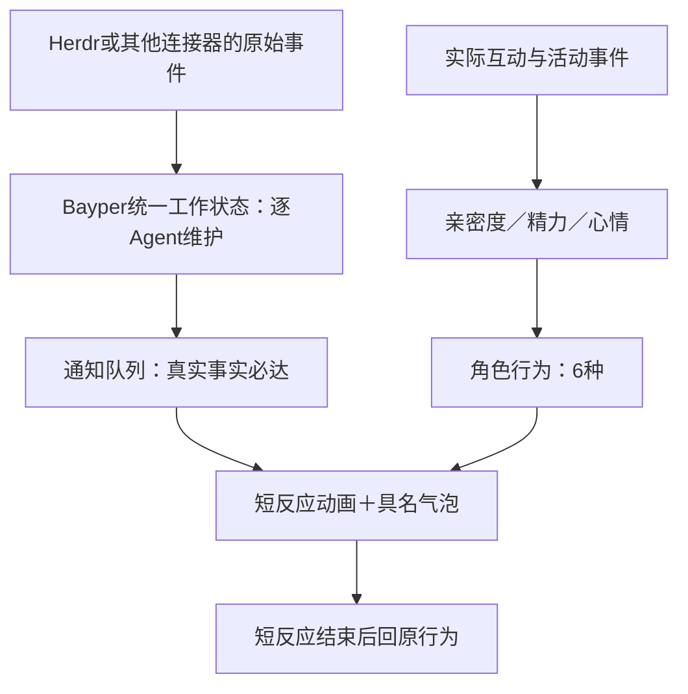

# Bayper状态、数值与活动节奏

状态：Codex提出的首版讨论默认，2026-10-25；未实现或体验验证。产品依据为 [PRD](prd.md)，名单和交接规则见 [陪伴规则](companionship-rules.md)。数值是可调整的体验预算，不是外部标准。

## 状态分层与数量

建议采用 **6个角色行为状态＋7种统一工作状态**。连接器状态另用于描述来源连通事实；亲密度、精力、心情是连续或离散属性，不再各自乘出一批行为状态。帧动画按语义映射，不按所有组合穷举素材。

状态值由Bayper定义，连接器只做有依据的映射。工作状态变化触发通知和短反应，**不直接扣精力、改变亲密度或心情**；数值依据实际角色互动与活动变化，不依据帧数、重复状态快照或气泡数量变化。

## 6个角色行为状态

| 状态 | 含义与入口 | 帧动画语义 | 数值规则 |
| --- | --- | --- | --- |
| 陪伴 companion | 默认安静在场，小窝候场也可用本地闲适表现 | 呼吸、眨眼、偶尔视线/尾摆的循环 | 同屏轻耗精力，小窝候场恢复；无自动亲密增长 |
| 互动 interacting | 用户主动聊天、点触等明确互动；名单外临时聊天也适用 | 侧耳倾听、看向用户、轻回应；不每条消息换大动作 | 轻耗精力；有意义互动可增加亲密与短期心情 |
| 日常 daily | 一次有界的小活动、玩耍或故事分享，不是基础待机循环 | 伸展、整理服装、翻书、轻玩耍等已制作短动作 | 实际活动扣一次少量精力，可有短期心情变化 |
| 探索 exploring | 合资格名单成员的一次受限探索；不同时充当同屏者 | 出发/返回；过程不要求屏外持续渲染 | 开始执行扣一次精力；结束不重复扣、不保证线索 |
| 休息 resting | 低精力、主动休息或无人适合接班 | 坐下、趴睡、安静休息循环 | 恢复精力；不降低亲密，不需用户照料 |
| 交接 transitioning | 当前自然节点结束后入场、退场或换人 | 简短告别、入场、走出边缘 | 不额外扣精力，不重置数值或角色上下文 |

每位角色同一时刻只有一个主行为。当前同屏最多1位，名单与位置是资格/归属信息，不是另一套动画状态。日常与探索须有明确结束点，不因模型继续发散而无限延长。

### 短反应动画

工作事件使用5类可复用的短反应：**专注、提醒、欣喜、关切、招呼**。它们是短暂表演，不是新的长期行为状态；能复用已有帧就不额外扩充状态。每位角色用符合设定的细微动作表达，欣喜也不代表来源工作已经业务验收成功。

短反应结束后恢复原行为、进度与数值。聊天时优先用必要气泡和轻表情，不强制退出互动；休息时可只显示事实气泡，不必叫醒。探索中的角色不瞬移到桌面，应用或当前同屏者承担通知。必要文字不等动作完成，既有P0/气泡规则保持。

## 7种Bayper统一工作状态

这是每个外部工作对象/Agent的事实状态，不是角色的体力或人格。保留原始状态、来源和时间，避免映射丢掉语义。

| 状态 | 需要的来源证据 | 对应反应与通知 |
| --- | --- | --- |
| 空闲 idle | 明确空闲/待命 | 普通事实表达，可复用陪伴动作 |
| 工作 working | 明确开始/继续处理 | 专注短反应；不强制角色一直重复“工作”动画 |
| 待处理 needs_attention | 明确需要输入、确认或用户介入 | 提醒，P0；保留真实待处理标记 |
| 已结束 finished | 来源明确本轮工作结束/结果可看 | 欣喜或符合设定的收尾，P1；不推定业务成果正确 |
| 异常 failed | 来源明确失败或错误 | 关切，P1；不能从done或终端文字模糊猜测 |
| 已停止 stopped | 明确该工作对象退出/终止 | 关切或收尾，P1；不当作成功完成 |
| 未知 unknown | 启动待快照、断档、无法确认当前状态 | 明示暂不可确认；不误报完成或失败 |

连接器仍区分连接中、在线、重连中、离线。连接器掉线不等于每个Agent已停止：受影响对象暂不可确认，来源断联按既有3秒观察期提示；明确server stop可以提示来源下线，但不补造所有任务完成事件。没有证据的原始值先保留并作为未知，不强配成某个积极状态。

同一事件身份只映射、通知一次，真实往返变化仍各自保留。新连接器必须说明它能提供哪些语义；缺失状态不能宣称全部支持。连接上线/恢复可用招呼反应，与Agent工作状态分别记录。

## 三项数值默认

默认值和变化是系统按实际事件结算，模型不能自由写任意增减；重复帧、重复返回、失败重试和重新打开不重复计分。数值计算不单独调用模型。

三项始终限制在各自范围，时间恢复以实际间隔结算，不因时钟回拨产生负恢复。每日亲密计数按本地自然日记录；自动请求额度使用滚动时窗，不能把两种“每天”混为重置机制。

### 亲密度：0～100，初始10

- 每位角色每天首次有意义的主动互动＋1；当天首次真实共同故事/共同活动再＋1，**每日最多＋2**，不是要求用户完成两项任务。
- 连续重复点按、刷同一句、自动问候或被忽略的邀请不增加；普通陪伴不按分钟自动刷满。
- 不因没打开、没回应、换人、精力低、拒绝邀请或用户纠正理解而下降。当前默认没有日常负增长或照料欠账。
- 影响表达熟悉程度和分享方式，不作为基础聊天、通知、接纳角色的门槛；重要记忆不靠亲密阈值决定是否有效。
- 有意义事件以真实互动类别为依据，不能为了判断是否加1再发一轮评审API；边界后续体验细化，不显示打卡任务。

### 精力：0～100，初始100

| 情境 | 默认变化 |
| --- | --- |
| 同屏安静陪伴 | 每实际运行小时－6，缓慢累计；不按动画帧扣 |
| 主动互动 | 替代该段安静陪伴消耗，每有效互动15分钟－2，最多－8/小时；不按消息条数扣 |
| 一次短日常活动 | 执行开始时－2，只扣一次；其时段不再叠加陪伴/互动耗时 |
| 一次探索 | 实际开始时－8，只扣一次；整个探索时段不再叠加耗时扣除，重试不重复扣 |
| 小窝候场 | ＋10/小时 |
| 休息，包括同屏安静休息 | ＋20/小时 |
| 应用关闭、锁屏或系统休眠 | ＋10/小时，按实际间隔有上限地补算，封顶100，不补做活动 |

同一时间段只使用一种耗时变化规则，不同时恢复和扣除；进入交接的短时间不额外记消耗。未真正执行的活动不扣精力，主动聊天的有效互动时间不包含长时间等用户或请求失败等待。

精力≤30时准备休息，停止追加自动活动，完成当前自然节点后交接；候场需恢复至≥60，且距离上次自动退场至少30分钟。进入探索要求精力≥60，日常要求>30；规则不应用到必需通知上。

聊天中不因低精力硬退场；回合结束可表现倦意，继续聊天不额外发催促休息的消息，也不在0以下形成欠账。用户可以结束后让她休息，自动轮换等聊天结束。没人可接替时本地休息，不能强派下一位。

安静陪伴满精力可持续很久，系统不以“每位今天都必须上岗”加速消耗。恢复全部自动完成，无需喂养、签到或照顾操作。

### 心情：-2～2，初始0

- 一次愉快的真实互动或有趣活动可＋1；同类事件每30分钟最多影响一次，重复点击不叠加。
- 一次明确的活动受挫可－1，同类负向影响每小时最多一次；不把模型/API失败、Herdr任务失败或用户纠正当作角色受伤。
- 没回应、没上线、换人、拒绝邀请不扣心情，不用负面表达迫使用户补偿。
- 无新影响时，每30分钟向0回归一档；关应用也自然恢复，角色间不互相放大负面数值。
- “精力低”表示累，不自动等于生气；“心情低”改变细微语气与动作，不改写底色，不屏蔽功能。友好表达仍遵循角色设定。

## 自动活动与API节奏默认

所有频率按**整个应用**计算，不按5位名单或全部角色分别翻倍。以下是上限和机会，不是必须完成的工作量。

| 项目 | 默认 |
| --- | --- |
| 本地轻微表现 | 待机循环自然播放；可每5～10分钟穿插一次2～4秒的小变化，无API、不扣精力、不强发气泡 |
| 自动活动机会 | 每30分钟最多评估一次，合资格时25%概率选一位；聊天中、低精力、预算不足或冷却未到直接跳过，不排欠账 |
| 自发短日常活动 | 全局最多1次/小时，可不发生；实际活动一般5～15秒，不为占满额度安排工作 |
| 探索 | 全局最多1位同时进行，滚动4小时最多1次、24小时最多2次；一次15～30分钟，不持续轮询模型 |
| 自动模型请求 | 全局滚动1小时最多1次、8小时最多4次、24小时最多6次；有请求在途时不再开新的自动请求 |
| 同一角色自动模型机会 | 相邻两次至少间隔2小时；不因角色切换或更名绕开 |
| 自动气泡分享/邀请 | 全局最多1次/小时、8小时最多3次；当前互动/通知忙时延后或省略，不追着用户连发 |

自动机会选中后，只选一种受限活动，不同时派一批角色。纯本地日常可以不用API；需要模型的活动最多1次模型请求，把必要表达集中完成，不建立计划—反思—评审的多轮自主链。探索期间不为“仍在旅行”发请求；是否有线索不保证。

请求次数按实际发送尝试计算，失败也占自动预算；默认不立即自动重试，下个合法机会再考虑。模型提炼、来源分析和角色共享如另发自动请求，也消耗上述应用总量，不能改名为维护任务绕过上限。自动预算不按自然日零点清空，名单刷新不重置冷却。

显式用户聊天不参加随机抽签，也不因自动额度用完而被拒；遵守用户的调用设置和服务限制，优先于尚未开始的自动任务。后台自动请求不发起与用户输入竞争的新任务；已在途请求的等待/取消体验后续技术验证，不承诺网络中断瞬时生效。

Agent必需通知、本地数值更新、名单刷新与动画播放都不需要模型；真实工作通知不受自动气泡/自动API额度限制。通知频繁时优先事实表达，自动故事与活动不挤入制造更多打扰。

锁屏、休眠、关闭应用期间不产生新自动活动。恢复仅补算合理的休息与心情回归，不补抽机会、不追发自动分享、不欠亲密度；API限额与现有事件身份保留。

## 典型情境检查（纸面推演，非实测）

| 情境 | 预期 |
| --- | --- |
| Agent频繁工作→待确认→继续 | 各变化具名通知，按既有节奏短反应，角色数值不跟着反复增减 |
| 用户长聊至精力≤30 | 当前聊天继续、不派新活动，聊天结束且节点收束后准备休息 |
| 五位名单成员都有空 | 每次机会只选一位，仍受全局每小时与滚动额度限制 |
| 用户一周没开 | 亲密不下降，精力/心情自然恢复；无一周的模型任务欠账 |
| 当天已无新角色/服装可发现 | 日常陪伴与已有主题内容继续，不为产出线索无意义追加请求 |
| 全员精力低 | 当前本地休息、应用照常通知；不要求用户照料才能恢复 |

本轮只定义业务状态、素材语义和讨论默认，不实现状态机、连接器映射、数值结算或API调度。首版角色需要覆盖哪些实际帧、每段帧数和时序，仍按选定素材与播放验收确定。
