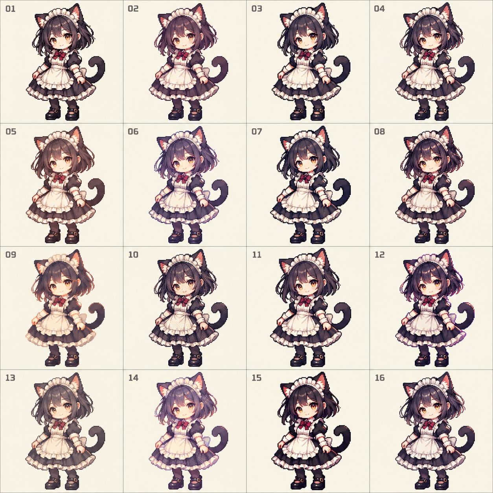

# 女仆系列画风对照：第二轮

日期：2026-10-25。阶段：PRD 画风讨论。首批主题已由用户指定为“女仆系列”，本轮样本为原创猫咪女仆。角色素材随版本按主题增加，不在 Bayper 运行时生成图片造型。



## 用户偏好与本轮控制

- 精细二次元效果参考[首轮](style-exploration.md)16号；比例参考首轮11/14号，采用更紧凑的大头短身，避免首轮16号的修长比例。
- 用常见动漫猫娘女仆元素制作原创角色：黑紫短发、金瞳、猫耳尾巴、褶边发箍、黑白女仆裙、围裙与红色领结。没有选取或声称复刻某部动漫角色，也没有进行动漫资料检索。
- 同一角色与基本服饰、相近站姿，比较精细像素的细分画法。本轮提示的约3至3.3头身只是生成约束，未逐像素测量，也不作为已冻结的生产参数。

| 编号 | 比较方向 |
| --- | --- |
| 01 | 均衡、清楚的深色选择性轮廓 |
| 02 | 紫色轮廓与柔和阴影 |
| 03 | 深轮廓、较明确的色阶 |
| 04 | 细轮廓与细致眼睛、褶边 |
| 05 | 暖褐色与奶油白，温暖柔和 |
| 06 | 淡紫边缘与轻盈亮部 |
| 07 | 清楚的块面与强轮廓 |
| 08 | 更丰富的发丝和布料高光 |
| 09 | 弱轮廓与暖色块面 |
| 10 | 更明显的抖色、颗粒纹理 |
| 11 | 表情与圆润面部优先 |
| 12 | 较强的紫色亮边与明暗对比 |
| 13 | 灰褐、低饱和复古质感 |
| 14 | 粉紫反光与柔和梦幻配色 |
| 15 | 黑白对比与红色点缀 |
| 16 | 精细发丝、眼睛与褶边，利落的二次元像素 |

## Codex 审查与待选择

输出1254×1254，共16格、编号完整，角色全身可见；已更换猫咪女仆造型，整体更紧凑，保留猫娘人形特征。部分格子的差异较细，主要可辨差异是冷暖、轮廓、阴影和纹理，不称为16套完全不同的美术体系；候选编号不代表已确定的16位角色。

用户最初选定本轮 **10号** 的造型与紧凑比例；2026-10-26已认可凛新版像素母版，后续像素表达以 [当前角色画风基准](../../../assets/characters/STYLE.md) 为准，本图保留为初选来源。画风ID为 `bayper.pixel.maid10`，记录于 [造型元数据库](../../../tools/appearance-catalog/README.md)。图集的准确像素网格、透明边缘、小尺寸表现和动画一致性均未验收，不能直接当作正式素材；后续需据10号建立独立参考图、色板与制作标准，而非改选其他格。

## 生成记录

- 工具：Codex Desktop 内置 imagegen，非透明背景；未使用 CLI 或独立计费 API。
- 参考图：`assets/style-board-01.png`，只参考16号精细效果与11/14号比例，未沿用旅行服。
- 原始输出：`/Users/chaooswoo/.codex/generated_images/01a17121-7952-7433-8359-b082940fc70d/exec-18676a7b-3f50-4f91-99e4-b7c4fe1d8fe0.png`。
- 项目留存：原为本目录 `assets/style-board-02-maid.png`，现随造型资料工具迁入仓库根目录 `tools/appearance-catalog/references/style-board-02-maid.png`，只有这一份项目内有效参考；未覆盖首轮、未做程序化重绘。
- 以下保留给生图工具的原始英文提示词。

```text
Use case: stylized-concept
Create a NEW 4x4 sixteen-cell pixel-art style audition board for Bayper, catgirl MAID theme. Reference image is ONLY guidance: carry over the fine exquisite anime pixel rendering of its cell16, but adopt the compact, larger-head shorter-body silhouette of its cells11 and14. DO NOT repeat the old blue-haired traveler outfit or orange scarf. This is a new character and new board.
Subject in all16 cells: same original adult feminine anime CATGIRL MAID, human face and body with black cat ears and a graceful black tail, glossy dark plum-black bob with two longer side locks, amber-gold eyes, white frilled maid headband between ears, black and ivory modest short-sleeved maid dress with full knee-length layered skirt, white apron, small wine-red neck bow, opaque dark tights, rounded black Mary Jane shoes. Sweet, composed, slightly playful expression. Familiar anime catgirl-maid visual vocabulary, original character rather than a copy of an existing anime heroine. Fully clothed and nonsexual. No animal muzzle or quadruped bodies.
CRITICAL proportions: all16 are compact super-deformed adult anime mascots, about 3 to 3.3 heads tall including body, large expressive beautifully drawn face, short torso and legs, full rounded skirt. Proportions must resemble reference11/14, never reference16's elongated body. Not realistic anatomy, not tall fashion proportions. Both ears plus all feet visible, full body centered in every cell with equal character visual height, same calm standing front-three-quarter pose and matching basic costume for fair comparison.
CRITICAL medium: exquisite HIGH-DETAIL 2D ANIME PIXEL ART, tiny deliberate square pixel clusters, crisp stepped silhouette edges, detailed eyes and hair, beautifully articulated lace and fabric, controlled palette, no 3D, no smooth digital painting or vector art. Do not waste cells on extremely crude 8-bit. Compare nuanced but visibly different fine-pixel treatments. Don't merely recolor an identical drawing.
Layout square, exactly16 equal tiles, 4rows4columns, warm off-white solid backgrounds and faint thin separators. Small clear labels01 through16 in reading order, no other text, no title. Generous margins, no cropping or overlap.
Styles:
01 clean dark selective outlines, balanced classic black/ivory maid, polished modern anime game pixel art.
02 deep plum colored outlines, softer face shading, elegant delicate pixel clusters.
03 bold dark contour, clear two-tone cel shadows, exceptionally readable chibi silhouette.
04 very fine dark outlines, jewel-like amber eyes, meticulous small lace pixels, refined anime finish.
05 soft warm sepia contours, warm cream whites, gentle cozy anime pixel aesthetic.
06 pale lavender light-facing contours, darker shadow-facing outline, airy luminous fine pixel art.
07 controlled limited 16-color palette, deliberate large clean shadow clusters but highly detailed face.
08 rich 32-bit-style fine pixel shading, glossy dark hair, deep satin-like fabric pixel highlights.
09 minimal outer black outline, color-block silhouette and rich interior face details, lineless high-detail pixel art.
10 delicate ordered dithering only in shadow areas, fine retro-anime pixel texture.
11 stronger eyes and eyebrows, rounded face, tidy graphic fabric folds and highly expressive face.
12 jewel-tone shaded black/plum fabric, subtle rim light made of hard bright pixels, high contrast refined pixel art.
13 muted antique cream, grey-purple shadows, intricate restrained storybook pixel texture.
14 powder pastel reflected highlights on black dress, very soft palette yet crisp pixels, sweet dreamy anime finish.
15 dramatic black/white design, restrained wine-red accent, sharp tiny clusters and polished bold silhouette.
16 premium exquisite anime pixel finish, luminous amber eyes, individual hair-lock highlights, elaborate clean lace, fine selective contours, equal compact3-head body.
Preserve same catgirl identity and costume across16, vary rendering grammar and palettes as described. Avoid props, scenery, speech bubbles, weapons, sexualized clothing, long bare legs, elongated bodies, blur, watermark. This is a style comparison board, not an animation sheet.
```
