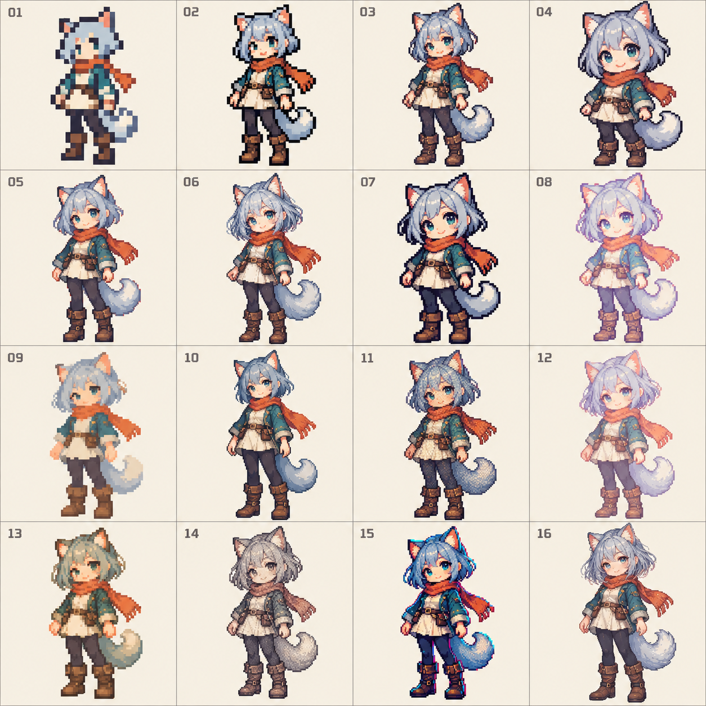

# 拟人像素画风对照

日期：2026-10-25。用途：PRD 阶段的画风挑选，不是正式角色或合格动画图集。使用 Codex Desktop 内置 imagegen，没有改用 CLI 或独立计费 API。



用户方向：2D、细腻而保留像素颗粒、“娘化”拟人角色而非纯动物。对照中统一使用银蓝发猫耳女性流浪者、橙围巾与旅行服，控制角色、姿势和服饰，主要观察画法差异。该形象是比较工具，不固定正式角色的物种、衣服或性格。

## 编号与观察

下表是生成意图与实际观察的索引，不是经像素测量确认的原生分辨率。图中字符高度和像素簇尺度不等于以后运行时的逻辑像素尺寸。

| 编号 | 风格方向 |
| --- | --- |
| 01 | 大颗粒、极简复古，细节最少 |
| 02 | 低分辨率感、深色轮廓与紧凑细节 |
| 03 | 传统 RPG 像素，轮廓与纹理较丰富 |
| 04 | 圆润大头 Q 版，强调表情 |
| 05 | 清晰现代像素，比例与细节较均衡 |
| 06 | 细密头发与眼睛，偏精细二次元像素 |
| 07 | 明显粗深轮廓、强对比 Q 版 |
| 08 | 浅紫彩色轮廓、柔和粉彩 |
| 09 | 弱轮廓、色块塑形、较粗像素簇 |
| 10 | 比例偏修长、阴影更利落 |
| 11 | 颗粒纹理、密集抖色，复古质感 |
| 12 | 低对比梦幻粉彩，边缘更轻 |
| 13 | 暖土色与苔绿，温暖生活感 |
| 14 | 低饱和灰褐、故事书式像素纹理 |
| 15 | 高对比深蓝与青红亮边 |
| 16 | 更修长与精细的二次元比例、细轮廓 |

Codex 审查：共16格、编号完整，均为拟人全身角色；粗颗粒、轮廓、比例、色彩与纹理有可见差异。03/05/06等部分画法仍较接近，不能宣称16种完全独立的美术体系。局部细节与头身比例随风格改变，角色一致性只达到概念比较用途；未做实际尺寸缩放、透明边缘、动作连续性或图集导入验收。

当前选择：待用户反馈编号。可以指定主风格并结合其他编号的一项特征；确认后再细化正式素材的比例、像素尺度、轮廓、色板与参考图，不提前冻结。

## 原始生成记录

- 工具：内置 imagegen，新图生成，无输入参考图，非透明背景。
- 原始输出：`/Users/chaooswoo/.codex/generated_images/01a17121-7952-7433-8359-b082940fc70d/exec-2f56d993-7874-4d26-854a-cb249c0348cc.png`。
- 项目留存：`assets/style-board-01.png`，保留原始位图，没有程序化重绘或图像编辑。
- 提示词为给生图工具的原始英文规格，文档说明与审查记录使用简体中文。

```text
Use case: stylized-concept
Asset type: Bayper desktop companion pixel-art STYLE AUDITION contact sheet.
Create one polished square 4 by 4 grid with EXACTLY SIXTEEN equal cells, clearly numbered 01 through 16 in reading order, small legible numbers top-left. Pale warm neutral flat backgrounds, thin understated dividers, no title, no other text.
In EVERY cell depict the SAME adult female anthropomorphic cat-eared wanderer, fully human feminine face and human body with cat ears and one fluffy tail, silver-blue bobbed hair, teal eyes, burnt-orange scarf, modest cream traveler tunic, short teal jacket, dark leggings and boots. Fully clothed, charming friendly personality, adult chibi stylization. This is a kemonomimi anime girl, NOT a quadruped cat, NOT a dressed animal. Consistent identity, outfit and identical standing relaxed front-three-quarter pose, entire figure including ears and boots inside every cell, matching visual height and plentiful margin.
The PURPOSE is visibly DIFFERENT PIXEL DRAWING STYLES, not sixteen near-identical recolors. Keep the outfit stable but deliberately vary pixel cluster scale, line treatment, body/head proportions, shading grammar and palette as specified. All art must be 2D pixel art with deliberate square hard-edged pixel clusters, no 3D, no vector smoothing, no painterly blur.
Cell styles:
01 chunky very low-resolution 24px-style sprite, large square clusters, four-tone nostalgic palette.
02 clean 32px-style 8-bit sprite, strong simple black contours, 8 colors.
03 classic 48px-style 16-bit JRPG sprite, compact readable clusters, selective dithering.
04 round 64px-style cozy chibi, thick dark outline, large expressive eyes and minimal shading.
05 modern crisp 96px-style indie pixel character, balanced anatomy, detailed hair and clothing, controlled palette.
06 exquisite 128px-style high-detail anime pixel portrait rendered full-body, refined small clusters and intricate eye highlights.
07 bold graphic pixel style, heavy near-black contour, high-contrast flat shadow shapes, 3-head tall chibi.
08 pastel colored-outline pixel art, delicate warm lavender outlines, cute and luminous, clean flat clusters.
09 lineless pixel art, silhouettes defined by touching color blocks, restrained warm palette.
10 cel-shaded pixel art, angular sharp clusters, hard two-level shadows, taller 4-head proportion.
11 richly textured retro pixel craft, ordered dithering and mottled cloth/hair, muted jewel colors.
12 soft dreamy pastel pixel style, very light shadows but visibly hard square pixels, finely drawn feminine features.
13 warm earthy cozy-game pixel style, honey/cream/moss, small handcrafted clusters and gentle proportions.
14 desaturated storybook pixel illustration, slate/sepia palette, delicate dark contour and dense restrained cross-dither.
15 neon-accent cyber pixel treatment, deep navy shadows and tiny cyan/coral accents on SAME outfit, crisp emissive-looking pixel highlights.
16 premium high-resolution 2D anime game sprite, elegant 5-head proportions, finely articulated strands and fabric, crisp selective outlines, elaborate controlled pixel clusters.
Ensure genuinely visible stylistic variation especially 01 versus 06 versus 09 versus 16, while preserving same identifiable character. Most cells should favor beautiful medium/high-detail pixel work. No sexualization, no weapons, no props, no scenery, no watermark. This is a comparison board, not an animation sheet.
```
