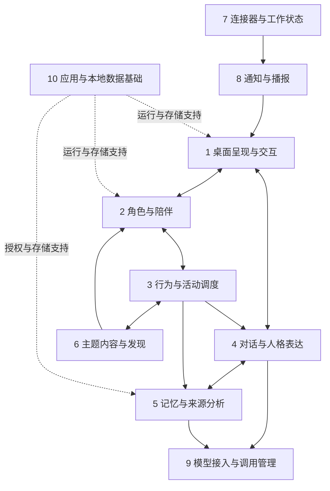

# 技术子系统职责划分

状态：Codex架构建议，基于现行PRD；仅划分责任与协作关系，不冻结详细技术设计、首版范围或开发计划。Electron已由用户确定。建议采用单应用内的模块化结构，10个逻辑子系统不对应10个服务、进程或数据库；实际进程安排后续按Electron边界决定。

## 8个业务子系统

| 子系统 | 承接的需求与唯一责任 | 与其他系统的边界 |
| --- | --- | --- |
| 1. 桌面呈现与交互 | 桌面角色、帧动画播放/衔接、点击拖动、聊天与管理窗口、普通/加急气泡的画面呈现 | 接受表达意图并报告动作自然节点；不自行决定名单、扣数值、生成通知事实或授予授权 |
| 2. 角色与陪伴 | 已结识角色、昵称、小窝归属、当日名单、固定位、当前同屏、亲密/精力/心情及交接规则 | 拥有角色运行状态与关系数值；不负责像素绘制或调用模型判断数值 |
| 3. 行为与活动调度 | 低频自主行为、日常/探索/分享、资格和冷却、暂停恢复、活动预算与并发、用户互动优先 | 依据陪伴状态组织活动；通过角色系统提交状态变化，通过内容系统推进故事，不私存另一套角色状态 |
| 4. 对话与人格表达 | 主动聊天、每位角色会话上下文、稳定性格与自然表达、记忆辅助回应 | 使用角色设定与已授权记忆组织表达；模型文本不能直接改身份、授权、解锁或工作事实 |
| 5. 记忆与来源分析 | 独属记忆、共同经历、定向共享、纠正删除与防回流、经授权的Coding Agent会话导入和分析 | 来源文件不是记忆本体；只向合适角色提供有效记忆，读取须通过授权检查，自动分析纳入活动预算 |
| 6. 主题内容与发现 | 版本角色设定、服装与动画资源目录、主题故事、线索进度、相遇邀请、解锁资格 | 拥有内容定义与进度；接纳由角色系统建立关系，穿用需校验已解锁资源，模型不能凭空制造可用素材 |
| 7. 连接器与工作状态 | Herdr插件适配、发现关联、实例/Agent身份、重连、快照对账、外部状态映射 | 输出独立工作对象的标准事实；不直接控制角色动画，不因建立连接获得会话目录分析权限 |
| 8. 通知与播报 | 事实事件去重、优先级、聚合、普通队列、独立加急通道、可见时限和历史 | 使用呈现系统显示3普通位置＋1加急位置；事实表达不等待模型，不被角色心情、休息或自动活动额度阻断 |

## 2个共用基础子系统

| 子系统 | 责任 | 边界 |
| --- | --- | --- |
| 9. 模型接入与调用管理 | OpenAI兼容服务配置、调用、取消、失败反馈、全局调用额度核验与用量记账 | 活动调度决定何时申请；此处统一执行请求限制。主动聊天与自动活动按不同规则计账，不用自动额度误挡主动聊天，不以重试绕过限制 |
| 10. 应用与本地数据基础 | Electron生命周期、OS窗口/托盘/焦点能力、休眠恢复事件、SQLite持久化与迁移、设置、凭据保护、目录授权执行、日志 | 提供共用能力；各业务系统拥有自己的数据语义，不能把所有业务逻辑塞进Electron入口或通用数据库层 |

## 主要协作

图中只绘制主要关系；基础能力服务于全部业务模块，不为画全依赖而铺满箭头。主题内容也为对话提供人格设定、为呈现提供资源；通知可请求人格化措辞，但已知事实先行表达，不形成强依赖。

## 四条贯穿路径

- **聊天**：交互入口→对话系统读取角色设定与有效记忆→模型调用→呈现回复；需要形成/纠正记忆时回到记忆系统，不直接改数据库绕过语义。
- **探索**：调度检查资格→陪伴系统安排退场/接替→执行活动→内容系统记录有效线索→记忆系统保存真实经历→呈现分享。虚构主题故事不冒充真实目录探索。
- **工作通知**：Herdr适配→标准Agent状态→通知规则→普通或加急位置。此路径在模型不可用、角色休息和探索时继续成立。
- **新角色**：主题故事与线索→相遇邀请→用户确认→角色系统建立已结识关系。不会自动改今日名单或同屏位置，也不会复制其他角色全部记忆。

## 制作工具的归属

造型元数据库、素材生成、切帧和校验属于内容制作工具链，项目专用工具自包含于tools/。产物由主题内容系统登记、由呈现系统消费；这些不是额外的用户侧业务子系统。各子系统是维护和验收边界，后续任务仍应沿完整使用流程纵向协作，不按十个系统分别做完再集成。
